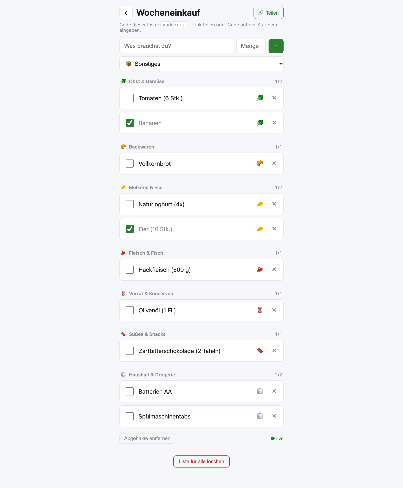
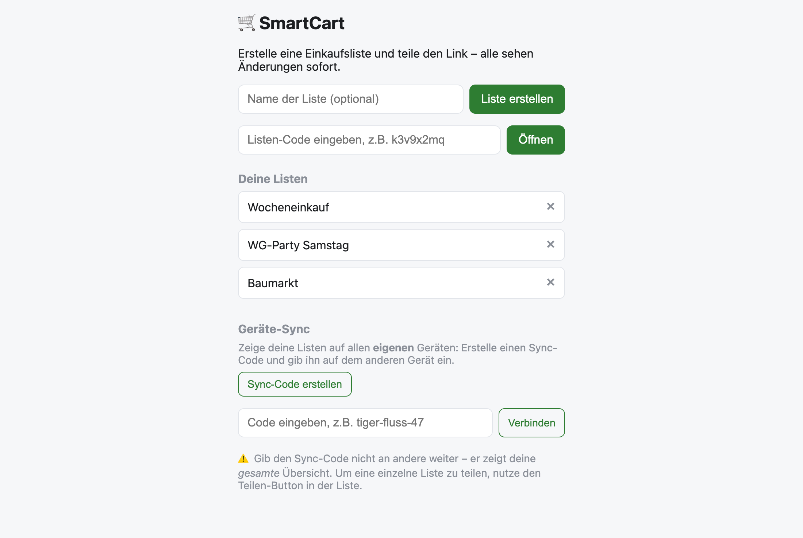
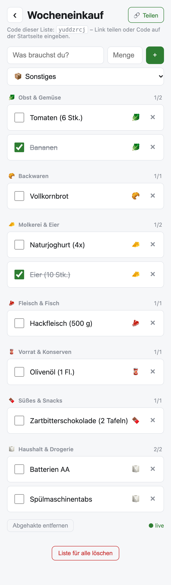

<div align="center">

# 🛒 SmartCart

**Geteilte Einkaufsliste mit Echtzeit-Sync – ohne Login, ohne App-Store.**

Liste anlegen, Link teilen, gemeinsam einkaufen: Hakt jemand „Milch“ ab,
verschwindet sie im selben Moment auf allen anderen Geräten.

[](https://github.com/Jannes96/smartcart/actions/workflows/ci.yml)
[](https://nodejs.org)
[](LICENSE)
[](https://fly.io)

**[▶ Live-Demo: smartcart-jannes.fly.dev](https://smartcart-jannes.fly.dev)**

</div>

---

<p align="center">
  
  
</p>

<p align="center">
  
  <br>
  <em>Als PWA installierbar – auf dem Homescreen nicht von einer nativen App zu unterscheiden.</em>
</p>

## Warum das Projekt existiert

Einkaufslisten-Apps verlangen fast alle einen Account – für eine Liste, die man
zu zweit für 20 Minuten braucht. SmartCart dreht das um: **eine URL ist die
Liste**. Wer den Link hat, ist dabei. Kein Login, kein Onboarding, keine
Datenschutzerklärung zum Wegklicken.

Technisch war es für mich die Gelegenheit, Echtzeit-Sync einmal ohne fertiges
Framework (Firebase, Supabase, Socket.IO) zu bauen – roher `ws`-Server, eigenes
Subscribe/Broadcast-Modell, optimistische UI im Frontend.

## Features

| | |
|---|---|
| ⚡ **Echtzeit-Sync** | Änderungen landen über WebSockets sofort bei allen, die dieselbe Liste offen haben |
| 🔗 **Teilen per Link oder Code** | Jede Liste hat eine ID wie `k3v9x2mq` – als URL teilen oder auf der Startseite eintippen |
| 🗂️ **Kategorien** | Artikel lassen sich einsortieren (Obst & Gemüse, Molkerei, Tiefkühl …); die Liste gruppiert sich danach |
| 🔓 **Kein Login** | Keine Accounts, keine E-Mail, keine Passwörter |
| 📱 **PWA & offline** | Installierbar auf iOS/Android; Service Worker cacht die App-Shell und die zuletzt geladenen Listen |
| 🔄 **Geräte-Sync** | Optionaler Sync-Code (`tiger-apfel-50`) hält die Listen-Übersicht über mehrere eigene Geräte synchron |
| 🪶 **Kein Build-Step** | Vanilla JS im Frontend, drei Dependencies im Backend, ein Container |

## Stack & Architektur

```
Browser (Vanilla JS, PWA)
   │  REST für Schreibzugriffe          ┌──────────────────────────┐
   ├──────────────────────────────────► │  Express                 │
   │                                    │   ├─ /api/lists          │
   │  WebSocket für eingehende Events   │   ├─ /api/profiles       │
   ◄─────────────────────────────────── │   └─ /ws  (Subscribe +   │
                                        │           Broadcast)     │
                                        └───────────┬──────────────┘
                                                    │ better-sqlite3 (sync)
                                                    ▼
                                        SQLite auf Fly.io-Volume
```

- **Backend:** Node.js 22, Express 4, [`ws`](https://github.com/websockets/ws)
- **Datenbank:** SQLite via `better-sqlite3` (WAL-Modus, Foreign Keys an)
- **Frontend:** Vanilla HTML/CSS/JS, vom selben Server ausgeliefert – kein Bundler, kein Framework
- **Tests:** `node:test` (Node-Runner, keine Test-Dependency)
- **Deployment:** Multi-Stage-Dockerfile → Fly.io, SQLite auf persistentem Volume

### Bewusste Entscheidungen

| Entscheidung | Warum | Trade-off |
|---|---|---|
| **REST schreibt, WebSocket liest** | Schreibpfad bleibt debug- und cachebar (`curl`, DevTools-Netzwerktab); der Socket transportiert nur Events | Zwei Kanäle statt einem |
| **SQLite statt Postgres** | Bei dieser Last ist ein Netzwerk-Hop pro Query pure Latenz. `better-sqlite3` ist synchron und damit ohne `await`-Rauschen im Code | Bindet die App an **eine** Maschine |
| **Kein Frontend-Framework** | ~330 Zeilen `app.js` reichen für diese UI. Kein Bundler heißt: Datei ändern, F5, fertig | Kein Komponentenmodell, wenn die App wächst |
| **Kein Auth** | Die Liste *ist* die URL. Auth wäre mehr Code als das Produkt | Wer den Link hat, darf alles (siehe unten) |
| **Kategorien in Laufweg-Reihenfolge** | Die Gruppen stehen in der Reihenfolge, in der man den Supermarkt abläuft – nicht alphabetisch. Das ist der ganze Zweck der Funktion: oben Obst & Gemüse, unten Haushalt | Passt nicht zu jedem Laden |
| **Kategorie manuell statt geraten** | Ein Wörterbuch, das „Kokosmilch" unter Molkerei einsortiert, ärgert mehr als es hilft. Ein Dropdown liegt immer richtig | Ein Klick mehr pro Artikel |
| **ID mit 8 Zeichen aus 36** | ~2,8 Billionen Kombinationen, `crypto.randomBytes` – nicht erratbar, aber noch abtippbar | Keine Sperre gegen systematisches Durchprobieren |

### Sicherheitsmodell (ehrlich)

Wer die Listen-URL kennt, kann die Liste lesen, ändern und löschen – das ist das
Feature, nicht der Bug. Es gibt bewusst keine Rechteverwaltung. Der **Sync-Code**
ist dagegen faktisch ein Passwort: Er gibt die gesamte Listen-Übersicht eines
Geräts frei und gehört nicht in geteilte Chats.

Für ein Produkt mit echten Nutzerdaten fehlten hier: Rate-Limiting,
Ablaufdatum für Listen und ein Auth-Layer für die Sync-Profile.

## Lokal starten

```bash
git clone https://github.com/Jannes96/smartcart.git
cd smartcart
npm install
npm run dev
```

→ http://localhost:8080. Die SQLite-Datei landet unter `./data/smartcart.db`
(per `.gitignore` ausgeschlossen). Über `DATABASE_PATH` lässt sich der Ort ändern.

### Tests

```bash
npm test
```

Die Tests starten den echten Server auf einer temporären SQLite-Datei und prüfen
den kompletten Weg: REST-Endpunkte, Validierung, 404-Verhalten, Sync-Profile und
dass ein `POST /items` tatsächlich als `item:added` über den WebSocket ankommt.

### Docker

```bash
docker build -t smartcart .
docker run -p 8080:8080 -v smartcart_data:/data smartcart
```

## Deployment (Fly.io)

```bash
fly launch --no-deploy
fly volumes create smartcart_data --region fra --size 1
fly deploy
```

> **Achtung:** genau **eine** Maschine. SQLite liegt lokal auf dem Volume und der
> WebSocket-State (`listId → Set<WebSocket>`) ist In-Memory – zwei Instanzen sähen
> weder dieselben Daten noch dieselben Abonnenten. Für mehrere Regionen bräuchte
> es LiteFS oder Postgres plus einen Pub/Sub-Kanal (z.B. Redis) zwischen den Nodes.

## API

Alle Antworten sind JSON; Schreiboperationen lösen zusätzlich ein WebSocket-Event aus.

| Methode | Pfad | Beschreibung | Event |
|---|---|---|---|
| `POST` | `/api/lists` | Liste anlegen `{ name? }` | – |
| `GET` | `/api/lists/:id` | Liste inkl. Items laden | – |
| `DELETE` | `/api/lists/:id` | Liste endgültig löschen | `list:deleted` |
| `POST` | `/api/lists/:id/items` | Item hinzufügen `{ name, quantity?, category? }` | `item:added` |
| `PATCH` | `/api/lists/:id/items/:itemId` | Item ändern `{ checked?, name?, category? }` | `item:updated` |
| `DELETE` | `/api/lists/:id/items/:itemId` | Item löschen | `item:deleted` |
| `DELETE` | `/api/lists/:id/items` | Alle abgehakten Items entfernen | `list:cleared` |
| `POST` | `/api/profiles` | Sync-Profil anlegen → `{ code }` | – |
| `GET` | `/api/profiles/:code/lists` | Listen des Profils | – |
| `PUT` | `/api/profiles/:code/lists/:listId` | Liste zum Profil hinzufügen (idempotent) | – |
| `DELETE` | `/api/profiles/:code/lists/:listId` | Liste aus dem Profil entfernen | – |
| `GET` | `/healthz` | Health-Check für Fly.io | – |

Gültige Werte für `category` definiert [public/categories.js](public/categories.js) – die
Datei ist die einzige Quelle der Wahrheit und wird sowohl vom Server (Validierung)
als auch vom Browser (Dropdowns, Gruppierung) importiert. Unbekannte Werte werden
still auf `sonstiges` bzw. den bisherigen Wert zurückgesetzt, damit ein veralteter
Client kein Item unbrauchbar machen kann.

### WebSocket

```js
const ws = new WebSocket("wss://smartcart-jannes.fly.dev/ws");
ws.onopen = () => ws.send(JSON.stringify({ type: "subscribe", listId: "k3v9x2mq" }));
ws.onmessage = (e) => console.log(JSON.parse(e.data)); // { type: "item:added", item: {...} }
```

Ein Socket abonniert genau eine Liste; ein erneutes `subscribe` wechselt sie.
Der Server hält pro Liste ein `Set` von Sockets und räumt es beim `close` auf.

## Projektstruktur

```
├── server/
│   ├── index.js            # Express-Setup, statische Dateien, SPA-Route /list/:id
│   ├── db.js               # SQLite-Verbindung + Schema (idempotent beim Start)
│   ├── ws.js               # WebSocket-Server: Subscribe/Broadcast pro Liste
│   └── routes/
│       ├── lists.js        # Listen & Items
│       └── profiles.js     # Geräte-Sync-Profile
├── public/                 # Frontend ohne Build-Step
│   ├── index.html          # Beide Views (Übersicht + Liste), per hidden umgeschaltet
│   ├── app.js              # State, Rendering, REST-Calls, WebSocket-Handling
│   ├── categories.js       # Kategorien – von Server UND Browser importiert
│   ├── style.css
│   ├── sw.js               # Service Worker: App-Shell cache-first, API network-first
│   ├── manifest.json
│   └── icons/
├── test/api.test.js        # End-to-End-Smoke-Tests gegen den echten Server
├── docs/screenshots/
├── .github/workflows/ci.yml
├── Dockerfile              # Multi-Stage (Build-Tools nur in der Build-Stage)
└── fly.toml
```

> **Beim Ändern von Frontend-Dateien** `CACHE_VERSION` in
> [public/sw.js](public/sw.js) hochzählen – sonst bekommen installierte Clients
> weiter den alten Cache-Stand.

## Mögliche nächste Schritte

- [ ] Rate-Limiting auf den Schreib-Endpunkten
- [ ] Optimistisches Rendering auch bei Verbindungsverlust (Outbox-Queue im Service Worker)
- [ ] Ablaufdatum für unbenutzte Listen (DSGVO-Datensparsamkeit)
- [ ] Mengen als strukturierte Felder statt Freitext, damit sich Listen zusammenführen lassen
- [ ] Kategorie-Vorschlag beim Tippen (Wörterbuch), weiterhin überschreibbar
- [ ] Eigene Kategorien pro Liste, für Läden mit anderem Zuschnitt
- [ ] Postgres + Redis-Pub/Sub als Pfad zur horizontalen Skalierung

## Lizenz

[MIT](LICENSE) – Jannes Wilkesmann
